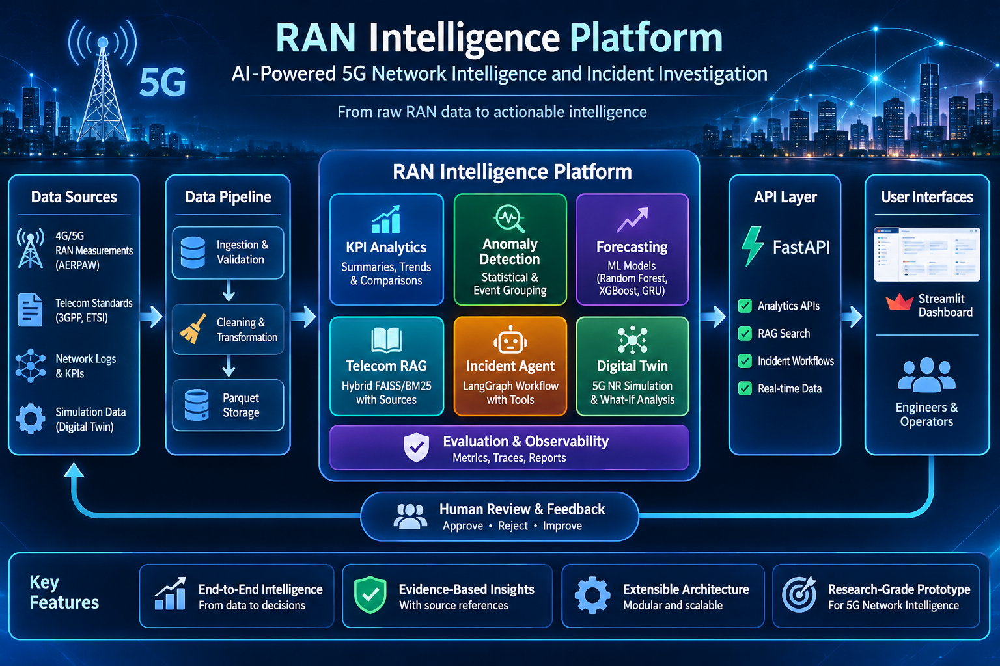

# RAN Intelligence Platform

**AI-Powered 5G Network Intelligence and Incident Investigation Platform**

An end-to-end research and engineering prototype for analysing 4G/5G Radio Access Network (RAN) measurements, detecting KPI anomalies, forecasting network performance, retrieving telecom standards, and assisting engineers with evidence-based incident investigation.

The platform is advisory. It does not connect to or make changes to live mobile networks.

## System Architecture



## Features

- **Data engineering:** ingestion, validation, cleaning, transformation and Parquet storage.
- **KPI analytics:** LTE/NR measurement summaries, session comparisons and time-series analysis.
- **Anomaly detection:** robust statistical detection and event grouping.
- **Forecasting:** persistence, Random Forest, XGBoost and GRU-based KPI forecasting.
- **Telecom RAG:** hybrid FAISS/BM25 retrieval, reciprocal-rank fusion, reranking and grounded answers with source references.
- **Incident investigation:** LangGraph workflow with KPI, anomaly, forecasting, RAG and simulation tools.
- **Digital twin:** simplified cell and user simulation with configurable network scenarios.
- **5G NR lab:** educational beamforming and scheduling experiments.
- **Evaluation and observability:** retrieval metrics, report checks, tool latency and investigation traces.
- **FastAPI backend:** versioned endpoints for analytics, retrieval and incident workflows.
- **Human review:** investigation reports pause for engineer approval or rejection.

## Architecture

```text
Public RAN measurements
        |
        v
Data ingestion and validation
        |
        v
KPI analytics and storage
        |
        +---- Anomaly detection
        +---- KPI forecasting
        +---- Telecom document retrieval
        +---- Network what-if simulation
                       |
                       v
             Incident investigation agent
                       |
                       v
              Evidence-based report
                       |
                       v
                 Human review
                       |
                       v
              FastAPI backend
                       |
                       v
               Streamlit dashboard
```

## Dataset

The data pipeline uses the publicly available AERPAW Ericsson 5G NSA RF and throughput dataset.

- Source: [Dryad dataset](https://doi.org/10.5061/dryad.wh70rxx06)
- The dataset contains two short measurement sessions.
- Radio and throughput observations are matched using timestamps with a 250 ms tolerance.
- Unmatched throughput observations are retained separately.

The dataset is limited in duration and coverage. Results are descriptive and experimental; they should not be interpreted as evidence of generalisation to operational mobile networks. Throughput units and measurement semantics should be verified before using them for operational conclusions.

## Technology

- Python, pandas, NumPy and PyArrow
- Pydantic and pydantic-settings
- scikit-learn, XGBoost and PyTorch
- Sentence Transformers, FAISS and BM25
- LangChain and LangGraph
- FastAPI and Streamlit
- Plotly and pytest

## Repository structure

```text
src/ran_intelligence/
    agents/          Incident investigation workflow
    analytics/       KPI analytics and visualisation
    api/             FastAPI application and services
    core/            Application configuration
    dashboard/       Streamlit application
    data/            Data ingestion and validation
    evaluation/      Evaluation and observability
    ml/              Anomaly detection and forecasting
    rag/             Telecom document retrieval and generation
    simulation/      Digital twin and 5G NR lab
tests/               Automated tests
data/                Local datasets and indexes (not committed)
artifacts/           Generated reports and evaluation outputs
```

## Setup in Google Colab

Clone the repository:

```bash
git clone https://github.com/PrashantSU/ran-intelligence.git
cd ran-intelligence
```

Install the project and required optional dependencies:

```bash
pip install -e ".[api,analytics,rag,agents,dashboard,dev]" pymupdf
```

The processed AERPAW dataset is expected at:

```text
data/processed/aerpaw/aerpaw_measurements.parquet
```

The telecom RAG index is expected at:

```text
data/processed/etsi/index/
```

The RAG index path can be overridden with `RAN_RAG_INDEX_PATH`.

Dataset files, downloaded documents, indexes, model weights and generated artifacts are not intended to be committed to Git.

## FastAPI

Start the API from the repository root:

```bash
uvicorn ran_intelligence.api.app:app --host 0.0.0.0 --port 8000
```

Interactive API documentation is available at `/docs`, with the OpenAPI schema at `/openapi.json`.

### Main endpoints

| Method | Endpoint | Purpose |
|---|---|---|
| GET | `/health` | Application health |
| GET | `/api/v1/data/summary` | Dataset summary |
| GET | `/api/v1/kpis` | Available KPIs |
| GET | `/api/v1/kpis/summary` | KPI summary |
| GET | `/api/v1/kpis/sessions` | Session comparison |
| GET | `/api/v1/kpis/timeseries` | KPI time series |
| POST | `/api/v1/anomalies/detect` | Detect KPI anomalies |
| POST | `/api/v1/forecasts/evaluate` | Evaluate KPI forecasts |
| POST | `/api/v1/rag/search` | Search telecom documents |
| POST | `/api/v1/incidents` | Start an investigation |
| GET | `/api/v1/incidents/{thread_id}` | Retrieve investigation state |
| POST | `/api/v1/incidents/{thread_id}/review` | Approve or reject a report |

## Incident investigation

An engineer submits an incident description, measurement session, time window and severity. The workflow can collect KPI, anomaly, forecasting, RAG and simulation evidence before producing a structured report.

The report distinguishes observed evidence from hypotheses. A statistical anomaly is not automatically a confirmed network fault, and a low SINR value alone does not establish interference as the cause.

The workflow pauses for human review. The engineer can approve or reject the report and provide feedback.

## Evaluation

The project includes automated tests for data processing, analytics, anomaly detection, forecasting, retrieval, agent workflows, API behaviour and report validation.

Retrieval metrics include Precision@K, Recall@K, reciprocal rank and NDCG. Agent evaluation includes tool execution status, evidence counts, latency and human-review state.

Evaluation results on this small dataset and manually judged retrieval queries are prototype measurements, not comprehensive production benchmarks.

## Important limitations

- The digital twin is a simplified educational system-level model, not a commercial or full 3GPP-compliant network simulator.
- The AERPAW dataset contains only two short sessions; forecasting results do not establish generalisation to unseen sessions or networks.
- The incident agent provides decision support, not autonomous fault confirmation or network control.
- LangGraph checkpoints and active incident-thread tracking currently use in-memory storage. They do not provide durable recovery across process restarts or coordination across multiple API workers.
- The RAG service loads a local BM25 pickle file. Only load indexes from trusted sources.
- The project is a prototype, not a production network-management platform.

## Development status

Core data engineering, analytics, anomaly detection, forecasting, telecom RAG, simulation, incident investigation, evaluation and observability are implemented and tested. The FastAPI backend is implemented. The Streamlit dashboard and final end-to-end integration are the remaining development work.

## License

Add a license before redistributing the project.
